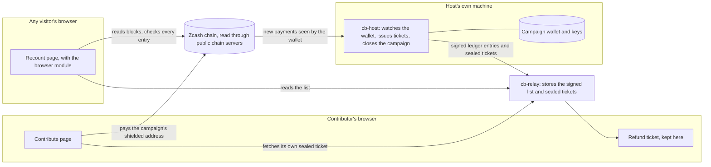

# How Clewbook was built

A plain language tour for someone new: what the parts are, how money and data move between them, what we wrote, what we borrowed, and what has and has not been proven. Technical words are explained the first time they appear.

## In one paragraph

Clewbook runs fundraisers and sealed bid auctions on Zcash, a cryptocurrency that can hide who paid whom. People pay a **shielded address** (an address whose payments are private) belonging to the campaign. The **host**, whoever runs the campaign, publishes a signed public list of everything that came in. Anyone can run a **recount** in their own browser, which checks that list against the public chain. Every contributor also holds a **refund ticket**: a transaction signed in advance that sends their money back to them, which they can broadcast themselves if the campaign fails or the host goes quiet.

## How the parts fit together

In words:

1. A contributor opens a campaign link. The page builds a payment in their browser: a random secret, a sealed note carrying their refund address and amount, and a payment code to scan with a wallet.
2. The wallet pays the campaign's shielded address. The payment lands on the Zcash chain.
3. The host program sees the payment through the campaign wallet, opens the sealed note, builds and signs the refund ticket in advance, seals it so only that contributor can open it, and writes a signed, numbered entry in the public list.
4. The host sends the list and the sealed tickets to one or more relays. A relay is a small web service that stores and serves them. It holds no secret and is not trusted: everything it serves is checked again by whoever reads it.
5. The contributor's page finds its own ticket on the relay and checks it on the contributor's own device.
6. Anyone can run the recount. The page reads the list, reads the chain, and reports pass or fail for each rule, check by check. If sources disagree it says it cannot conclude and never passes quietly.
7. After the deadline the host closes the campaign: a fundraiser that reached its goal keeps the money, otherwise everyone is refunded; an auction keeps the winning bids and refunds the rest.

## The story, with dates

All dates are 2026, from the commit log. About 220 of our own commits were made between 4 and 11 October.

1. **4 October: a fork and the core idea.** We started from an existing Zcash command line wallet, zcash-devtool (a tool by the Electric Coin Company). We changed it to build a transaction that never expires, hold it, and broadcast it later. This is the refund ticket. We also moved it to the prerelease libraries for NU7, the next Zcash network upgrade, which the test network turned on earlier than planned.
2. **4 and 5 October: spikes and a specification.** Small experiments answered the risky questions: can a ticket be held for days, can the sender's recipient key be discarded, can a coin be reserved. The first version of the written specification (`SPEC.md`) followed on 5 October.
3. **5 October: the core programs.** A shared library (rules, keys, the sealed note format, the signed list, the recount), the host, a contributor command line tool and a recount command line tool. The host got its wallet backend using the Zcash libraries directly. Closing, early withdrawal, auctions, challenges to wrongly rejected payments and re issuing tickets after an upgrade were exercised on testnet.
4. **5 October: the relay and the web.** The relay, then the contribute, campaign, recount and badge pages, a browser module (our Rust compiled to **WebAssembly**, a format browsers run), and the first host dashboard.
5. **6 October: first mainnet run, more auction types.** A first small real money run on the Zcash main network (two wallets, 0.002 ZEC each) took the idea outside the test network. The recount learned to compare up to three chain servers. Uniform price auctions (every winner pays the same price) and the extra checks R9 to R12 were added. A lock stopped two host processes working on one campaign. Copied payment notes were handled so that a note can count only once.
6. **7 October: amounts and design.** The payment note now seals the intended amount, so a smaller payment becomes a donation. The shared design system and self hosted fonts arrived.
7. **8 October: the mainnet pilot.** A phone wallet paid 0.0002 ZEC into a campaign, took it back with its own ticket, and the recount agreed. We also wrote the threat model, the evidence log, example data from finished testnet campaigns and a privacy test.
8. **9 October: operations.** A heartbeat so pages can warn when the host has not been seen lately, a command to change a campaign's relay, a page load failure notice, and a tested restore from a backup.
9. **10 October: hardening and a funded test pass.** The page server got an allow list and limits. Late payments, deadline cut offs and stalled chain servers were handled. A full set of scenarios ran on testnet with real test payments. The new pages went live.
10. **11 October: redesign, logo, moving house, public repo.** The page design and logo were redone, the page server and relay moved from the author's laptop to a small rented server so they stay up when the laptop is off, and the public repository was created.

## The parts, one line each

| Part | What it is |
|---|---|
| `cb-host` (`app/host`) | The host program: creates a campaign and its wallet, issues tickets, publishes, closes, and serves the local dashboard and set up page |
| `cb-relay` (`app/relay`) | The relay: stores and serves the signed list, sealed tickets, the host heartbeat and published challenges |
| `cb-contrib` (`app/contrib`) | The contributor's command line tool |
| `cb-recount` (`app/recount`) | The recount as a command line program |
| `app/core` | Rules, keys, the sealed note format, the signed list, and the recount logic that every other part shares |
| `app/ticketcheck`, `app/proofcheck` | Checks a refund ticket on the contributor's device; checks the proof inside it (the proof is the part that shows a shielded transaction is valid without revealing it) |
| `app/vectors` | Shared test values, checked against an independent encryption library |
| `app/web/www` | The pages: home, host guide, campaign, contribute, recount, capability card, badge |
| `app/web/src` | The browser module source: the same Rust as the host, compiled to WebAssembly so keys and checks run in the visitor's browser |
| `app/web/serve.py` | The page server: serves only an allow list of files with security headers, and forwards calls to two chain servers |
| `run.sh` | A helper that starts, stops and checks the programs on the author's machine |
| `src/` and the root `Cargo.toml` | The patched copy of zcash-devtool, used as the wallet tool |
| `SPEC.md`, `docs/` | The formats and rules, the threat model, the evidence and the findings |

## What we wrote and what we reused

We wrote everything under `app/`, the pages, the specification, the scripts and the tests. We reused all of the Zcash cryptography and wallet code, the signature and sealing libraries, the database, and the web and command line plumbing. We did not write any new cryptography. The one place we changed other people's code is the wallet tool described below. The libraries come unmodified from the public Rust package registry (no patched or vendored libraries).

| Library | Version | What we use it for | Declared licence |
|---|---|---|---|
| zcash_primitives, zcash_protocol, zcash_address, zcash_keys | 0.31.0-pre.0, 0.11.0-pre.0, 0.14.0-pre.0, 0.17.0-pre.0 | Zcash transactions, network rules, addresses, keys | MIT or Apache-2.0 |
| zcash_client_backend, zcash_client_sqlite | 0.25.0-pre.0, 0.23.0-pre.0 | Wallet scanning and storage, talking to chain servers | MIT or Apache-2.0 |
| pczt | 0.10.0-pre.0 | A partially created transaction: how a refund ticket is built, signed and held | MIT or Apache-2.0 |
| zcash_proofs, orchard, sapling-crypto, halo2_proofs | 0.31.0-pre.0, 0.16.0, 0.9.0, 0.4.0 | Shielded pools and the proof system | MIT or Apache-2.0 |
| reddsa, redjubjub | 0.6.1, 0.9.0 | Spend signatures | MIT or Apache-2.0 |
| zip32, zip321 | 0.3.0, 0.10.0-pre.0 | Key derivation, payment request links | MIT or Apache-2.0 |
| zcash-devtool (patched copy) | base commit 5a26ee8 | The wallet tool | MIT or Apache-2.0 |
| ed25519-dalek, x25519-dalek | 2.2.0, 2.0.1 | The host's signature on every list entry, key exchange | BSD-3-Clause |
| crypto_box, crypto_secretbox | 0.9.1, 0.1.1 | Sealed boxes for the payment note and the ticket | MIT or Apache-2.0 |
| blake2b_simd | 1.0.5 | Hashing | MIT |
| age | 0.12.1 | The key file that protects the wallet's seed phrase | MIT or Apache-2.0 |
| rusqlite (with bundled SQLite) | 0.37.0 | The wallet database | MIT |
| tonic, prost | 0.14.6, 0.14.4 | Talking to Zcash chain servers | MIT, Apache-2.0 |
| tiny_http, ureq | 0.12.0, 2.12.1 | The relay's web server, the host's calls to it | MIT or Apache-2.0 |
| wasm-bindgen | 0.2.129 | The glue between the browser module and the page scripts | MIT or Apache-2.0 |
| qrcode, clap, serde, serde_json | 0.14.1, 4.6.7, 1.0.229, 1.0.151 | Payment code image, command line, data format | MIT or Apache-2.0 |
| secp256k1 (a C library) | 0.33 | Needed by the Zcash libraries | not checked here |
| Zig | 0.14 | A build tool that compiles that C library for the browser, not shipped | not checked here |
| Archivo, Chivo Mono, Unbounded, Sora | files in `app/web/www/fonts` | Page text | SIL Open Font License 1.1 |

The full machine generated list of every library, with versions and declared licences, is in `THIRD_PARTY_NOTICES.md`.

## The one patch to someone else's code

The wallet tool is a copy of zcash-devtool (https://github.com/zcash/zcash-devtool) at upstream commit `5a26ee8` (28 August 2026). Every change is listed file by file in `CHANGES.md`. In plain words:

- **Signing fix.** The tool could not sign a spend from the Ironwood shielded pool (a newer Zcash pool): building the finished transaction failed. We made it sign those spends. Without this no refund ticket can be built. See `docs/FINDINGS.md` section 1.
- **New options on building a transaction:** an expiry height (so a ticket never expires), discarding the sender's key that would let others read the recipient, a minimum number of confirmations, and spending one chosen reserved coin.
- **A new command to reserve a coin,** so the wallet does not spend the coin a ticket depends on.
- **Two display changes:** showing a transaction's expiry height and the network version the server reports.
- **Library moves.** Most of the changed lines only adapt the tool to the NU7 prerelease libraries and a new random number interface.

There are no patches to any library. The whole difference is 49 files, most of it the lock file.

## What was proven, and where

Evidence is in `docs/EVIDENCE.md` (numbered sections) and the test table in [TESTS.md](TESTS.md). Short version:

- **On the test network:**
  - A ticket signed before a network upgrade is rejected after it, and re issuing under the new version works (section 1).
  - A spent coin cannot be refunded, and the evidence shows (section 2).
  - Refund recipients stay hidden from outsiders (section 3).
  - The three ways a campaign closes, and early withdrawal (section 4).
  - Rejected payments and the challenge rule, including a cheating host being caught (section 5).
  - Relay failures (section 6), uniform price auctions with a cheating test (section 7), and re sending dropped transactions (section 9).
  - A stress run of 40 contributions from 5 wallets, and a funded pass of the browser and scenario tests on 10 October.
- **On the main network (real money, small amounts), section 8:**
  - 6 October: two wallets paid, one took its money back early with its own ticket, the host refunded the other at close, and the recount passed. This used an earlier version of the pages.
  - 8 October: a phone wallet paid 0.0002 ZEC into a fundraiser, the ticket was issued and checked, the contributor took the money back with it, the campaign closed as goal missed, and the recount agreed. It ran on a single relay, so the recount was marked limited.
  - **Not tested on the main network with the current version:** the host refunding at close, re issuing across a real upgrade, the ticket proof and anchor checks, an auction, and a recount against several relays.

## Honest limits

- The main network has not had NU7 yet, so the host program refuses campaigns that could still be open when it activates. The mainnet update follows the upgrade and is not done.
- Keys live in plain files on the host's own machine. There has been no outside review of the code or the design. See `docs/HOSTING.md`.
- The host must stay online until the campaign closes. If it is off, new payments get no ticket.
- The relay accepts campaign registrations from anyone, so a public relay needs size limits.
- Amounts in a fundraiser, block times and the funding source of a payment can still help someone who already knows a person's payment. [PRIVACY.md](PRIVACY.md) lists what is hidden and what is not.
- Tested on Ubuntu under WSL only. A clean machine build has not been tried by anyone but the author.
- Dependencies are pinned to NU7 prerelease versions, which may change before release.

## Where to start reading the code

1. `SPEC.md`: the formats and rules in one place.
2. `app/core/src/rules.rs`: what a campaign's published rules are. Then `ledger.rs` (the signed list), `payload.rs` (the sealed note) and `recount.rs` with the folder `recount/` (the checks R1 to R12).
3. `app/host/src/main.rs`: creating a campaign, issuing tickets, closing. Then `ticket.rs`, `mainnet.rs` (the safety rules for real money), `outbox.rs` and `dashboard.rs`.
4. `app/relay/src/lib.rs`: everything the relay accepts and refuses, with its limits at the top.
5. `app/web/src/lib.rs` and `contribute.rs`: what runs in the browser. Then `app/web/www/public.js`, `contribute.js` and `recount-page.js`.
6. `app/web/serve.py`: the page server, short enough to read in one sitting.

## What we could not verify

- The licence column comes from each library's own declaration in the local crate cache. We did not read the licence texts, and for some libraries the source was not in the cache (marked in `THIRD_PARTY_NOTICES.md`). The secp256k1 and Zig licences were not checked.
- Library versions are taken from the lock files. We did not check them against the registry.
- Whether upstream zcash-devtool has since fixed the signing problem or changed the other points.
- Whether every modified source file carries a change notice. We did not edit upstream file headers, and `CHANGES.md` is our record of changes.
- The date announced for the mainnet NU7 upgrade was read from our notes, not from an official source.
